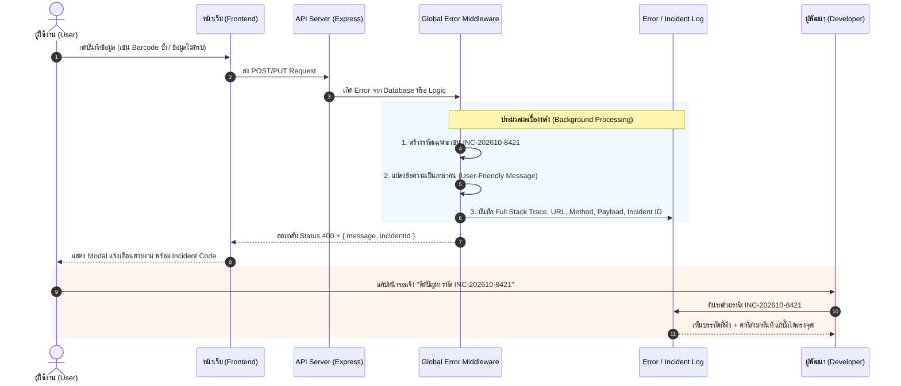

# 📋 แผนพัฒนาระบบ Enterprise Error Handling & Incident Tracking
> **โปรเจกต์**: ABCPOS (ERP & POS System)  
> **เป้าหมาย**:  
> 1. ผู้ใช้งาน (User) เห็นข้อความที่เข้าใจง่าย ตรงจุด และทราบว่าต้องแก้ไขข้อมูลอย่างไร  
> 2. ผู้พัฒนา (Developer) สามารถแกะรอยสาเหตุของบั๊กได้อย่างแม่นยำใน 1 นาที ผ่าน **Incident Reference Code**  
> 3. ไม่มีข้อความโค้ดดิบ (Stack trace / Prisma syntax) หลุดไปถึงหน้าจอผู้ใช้อีกต่อไป  

---

## 1. สถาปัตยกรรมการทำงาน (Architecture Overview)



---

## 2. การออกแบบรูปแบบการตอบกลับ (Standard Response Format)

เมื่อเกิดข้อผิดพลาดขึ้นในระบบ ไม่ว่าจะเป็น API เส้นใด จะตอบกลับด้วยรูปแบบ JSON มาตรฐานเดียวกันเสมอ:

```json
{
  "success": false,
  "incidentId": "INC-202610-9182",
  "error": {
    "title": "ข้อมูลซ้ำในระบบ",
    "message": "รหัสบาร์โค้ด '88591001' มีอยู่ในระบบแล้ว กรุณาระบุรหัสบาร์โค้ดอื่น",
    "field": "barcode",
    "code": "DUPLICATE_ENTRY"
  }
}
```

---

## 3. พจนานุกรมการแปลข้อความผิดพลาด (Error Mapping Dictionary)

ตัวกรองกลาง (Global Middleware) จะดักจับข้อผิดพลาดของฐานข้อมูล Prisma แล้วแปลเป็นภาษาไทยที่เข้าใจง่าย:

| ประเภท Error | รหัสทางเทคนิค | สาเหตุจริง | สิ่งที่ User จะเห็นบนหน้าจอ |
| :--- | :---: | :--- | :--- |
| **ข้อมูลซ้ำ (Duplicate)** | `P2002` | ชนฟิลด์ Unique (เช่น SKU, Barcode, Tax ID, Short Name) | **"ข้อมูล [ชื่อฟิลด์] '[ค่าที่กรอก]' มีอยู่ในระบบแล้ว กรุณาระบุข้อมูลใหม่"** |
| **ลบไม่ได้เพราะติดของอื่น** | `P2003` | Foreign Key Constraint (เช่น ลบหมวดหมู่ที่มีสินค้าอยู่) | **"ไม่สามารถลบรายการนี้ได้ เนื่องจากมีข้อมูลอื่นในระบบกำลังใช้งานอยู่"** |
| **หาข้อมูลไม่เจอ** | `P2025` | Record to update/delete not found | **"ไม่พบข้อมูลรายการที่ต้องการจัดการ หรือข้อมูลอาจถูกลบไปแล้ว"** |
| **กรอกข้อมูลไม่ครบ** | `VALIDATION` | ลืมกรอกฟิลด์ที่จำเป็น (Required) | **"กรุณากรอก [ชื่อฟิลด์] ให้ครบถ้วน"** |
| **ตัวเลขผิดเงื่อนไข** | `RANGE` | จำนวนติดลบ หรือราคาติดลบ | **"จำนวนและราคาต้องมีค่ามากกว่า 0"** |
| **ระบบขัดข้องภายใน** | `INTERNAL` | โค้ดพัง / เซิร์ฟเวอร์ดับ | **"ระบบขัดข้องชั่วคราว กรุณาแจ้งผู้ดูแลระบบพร้อมระบุรหัส [Incident ID]"** |

---

## 4. โครงสร้างตารางบันทึก Incident Log (สำหรับผู้พัฒนา)

เพิ่มตาราง `SystemIncidentLog` ลงในฐานข้อมูล (`prisma/schema.prisma`) เพื่อเก็บหลักฐานทุกครั้งที่เกิด Error:

```prisma
model SystemIncidentLog {
  id           String   @id @default(uuid())
  incidentCode String   @unique // e.g. INC-202610-8421
  timestamp    DateTime @default(now())
  
  // ข้อมูลฝั่งผู้ใช้งาน
  endpoint     String   // e.g. "/api/products"
  method       String   // "POST", "PUT", "DELETE"
  userIp       String?
  userName     String?  @default("Cashier/Admin")
  
  // ข้อมูลทางเทคนิคสำหรับ Dev
  statusCode   Int      @default(400)
  errorCode    String?  // e.g. "P2002", "P2003"
  errorMessage String   // ข้อความสำหรับ User
  payload      String?  // ข้อมูล JSON ที่ User ส่งเข้ามา (Request Body)
  stackTrace   String?  // Full Error Stack Trace ลึกถึงระดับบรรทัด
  
  resolved     Boolean  @default(false)
  createdAt    DateTime @default(now())
}
```

---

## 5. การแสดงผลบนหน้าจอ (UI/UX Feedback Modal Standard)

ปรับปรุง **Error Modal** ตามมาตรฐาน `GEMINI.md` ให้มีส่วนแสดง **Incident Code**:

```
+-------------------------------------------------------+
|                         /\                            |
|                        /  \  (ไอคอนเตือนสีแดง)          |
|                       / !  \                          |
|                      +------+                         |
|                                                       |
|                  ข้อมูลซ้ำในระบบ                       |
|   รหัสบาร์โค้ด '88591001' มีอยู่ในระบบแล้ว กรุณาระบุใหม่   |
|                                                       |
|   [ กล่องสีเทาอ่อนด้านล่าง: ]                         |
|   รหัสอ้างอิง: INC-202610-8421  [📋 กดคัดลอกรหัส]     |
|   (ใช้รหัสนี้เมื่อต้องการติดต่อฝ่ายสนับสนุน)          |
|                                                       |
|                       [ ตกลง ]                        |
+-------------------------------------------------------+
```

---

## 6. แผนการดำเนินการ 4 ขั้นตอน (Action Plan)

| ขั้นตอน | รายละเอียดงาน | ผลลัพธ์ |
| :---: | :--- | :--- |
| **เฟส 1** | **Backend Middleware & DB Model**<br/>- เพิ่มตาราง `SystemIncidentLog` ใน Prisma Schema<br/>- สร้าง `error.middleware.ts` ดักจับ Prisma P2002, P2003, Validation<br/>- ผูก Middleware เข้ากับ `server.ts` | Backend แปลง Error ทุกตัวเป็นภาษาคน และบันทึก Incident ID ลง DB อัตโนมัติ |
| **เฟส 2** | **Frontend Universal API Client**<br/>- อัปเดต `frontend/src/lib/api.ts` ทุกฟังก์ชันให้ดึง `data.error.message` และ `data.incidentId`<br/>- ป้องกันไม่ให้มีคำว่า `Failed to fetch/create` ลอยๆ อีกต่อไป | หน้าบ้านได้รับข้อความจริงพร้อม Incident ID เสมอ |
| **เฟส 3** | **UI Modal Enhancement**<br/>- ปรับปรุง Component `ErrorModal` ให้มีช่องแสดงรหัส Incident Code พร้อมปุ่ม Copy สะดวกๆ | User เห็นข้อความชัดเจน และแคปส่ง Dev ง่าย |
| **เฟส 4** | **หน้าจอ Incident Log Viewer สำหรับผู้พัฒนา**<br/>- สร้างหน้า `/activity-logs/incidents` เพื่อให้ผู้พัฒนาค้นหาเลข Incident และดู Stack Trace ได้จากหน้าเว็บทันที | Dev ตรวจสอบและแก้บั๊กได้ใน 1 นาที |
