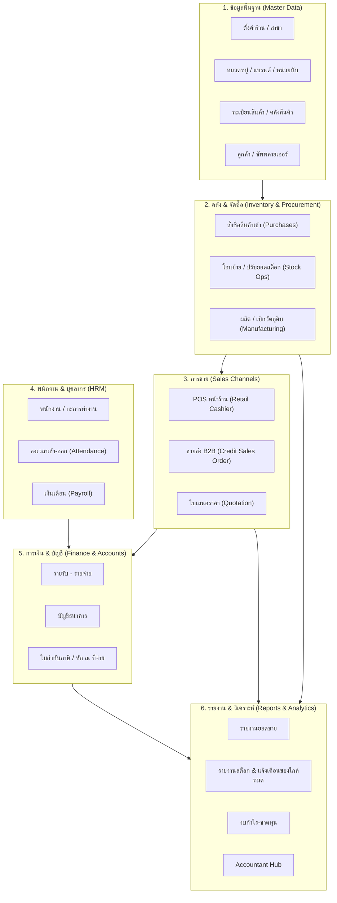

# คู่มือการใช้งานระบบ ABCPOS ฉบับสมบูรณ์ (Complete User Manual)
> **สำหรับ**: ผู้ใช้งานใหม่ที่ไม่เคยใช้งานระบบมาก่อน  
> **เป้าหมาย**: เข้าใจการทำงานทั้งหมดของระบบตั้งแต่ต้นน้ำถึงปลายน้ำ ผ่านการจำลองสถานการณ์จริง

---

## สารบัญระบบ (System Map)

ระบบ ABCPOS แบ่งหมวดหมู่การทำงานออกเป็น **7 เสาหลัก**:

---

## ส่วนที่ 1: ข้อมูลพื้นฐานที่ต้องมีก่อนเริ่มขาย (Master Data Setup)
*ถ้าเปิดระบบมาครั้งแรก ยังไม่มีข้อมูล ต้องเริ่มทำจากหมวดหมู่นี้ก่อน*

### 1.1 ตั้งค่าร้านและหน่วยนับสินค้า
1. **คลังสินค้า / สาขา (Warehouses & Stores)**:
   * ไปที่เมนู **Peoples** $\rightarrow$ **Warehouses** (`/warehouses`) และ **Stores** (`/stores`)
   * ตรวจสอบว่ามีคลังสินค้าหลัก (เช่น Main Warehouse, โกดัง 1) และสาขาหน้าร้าน (เช่น Main Store)
2. **หมวดหมู่และหน่วยนับ (Categories & Units)**:
   * **Categories** (`/categories`): ตั้งกลุ่มสินค้า เช่น เครื่องดื่ม, ของใช้, วัตถุดิบ, ถุงพลาสติก
   * **Units** (`/units`): กำหนดหน่วย เช่น ชิ้น (pcs), ลัง (box), กิโลกรัม (kg), แพ็ค (pack)
   * **Brands** (`/brands`): ยี่ห้อสินค้า

### 1.2 ทะเบียนสินค้า (Product Catalog)
* เมนู **Products** $\rightarrow$ **Product List** (`/products`)
* กดปุ่ม `+ Add Product` เพื่อเพิ่มสินค้า:
  * **ชื่อสินค้า / Barcode / SKU**: สำหรับยิงสแกนขายหน้าร้าน
  * **ราคาทุน (Cost Price)** และ **ราคาขาย (Selling Price)**
  * **จำนวนสต็อกเริ่มต้น (Quantity)** และ **จุดเตือนสต็อกขั้นต่ำ (Alert Quantity)**
  * *ฟังก์ชันพิเศษ*: สามารถพิมพ์บาร์โค้ดสินค้าได้ที่เมนู **Print Barcode** (`/barcode`)

### 1.3 คู่ค้า (Customers & Suppliers)
* **Suppliers** (`/suppliers`): ทะเบียนผู้ผลิตหรือผู้จำหน่ายที่เราไปซื้อของเข้ามา
* **Customers** (`/customers`): ทะเบียนลูกค้า (รองรับการกำหนดวงเงินเครดิต และเลขประจำตัวผู้เสียภาษี)

---

## ส่วนที่ 2: การสั่งซื้อและบริหารสต็อกสินค้า (Purchases & Stock)

### 2.1 การซื้อสินค้าเข้าคลัง (Purchases)
* เมนู **Purchases** $\rightarrow$ **Purchase List** (`/purchases`)
* **ขั้นตอน**:
  1. กด `+ Add Purchase`
  2. เลือก **Supplier** และ **Warehouse** ที่จะนำของเข้า
  3. เลือกสินค้าที่สั่งซื้อ กรอกจำนวนและราคาทุน
  4. เลือกสถานะเป็น `Received` (ได้รับของแล้ว)
  * *ผลลัพธ์*: ระบบจะเพิ่มจำนวนสต็อกสินค้าในคลังนั้นทันที พร้อมบันทึกประวัติการรับเข้า

### 2.2 การโอนย้ายและปรับยอดสต็อก (Stock Adjustments & Transfers)
* **Stock Transfers** (`/stock-transfers`): ย้ายสินค้าระหว่างสาขา เช่น โอนจากโกดังใหญ่ ไปหน้าร้าน
* **Stock Adjustments** (`/stock-adjustments`): ปรับยอดเมื่อของหาย, แตกหัก, หรือนับสต็อกจริงไม่ตรง

---

## ส่วนที่ 3: ระบบการขาย (Sales Channels)

### 3.1 การขายปลีกหน้าร้าน (Retail POS)
* เมนู **POS** (`/pos`) หรือปุ่มลัด POS มุมขวาบน
* **ขั้นตอนการขาย**:
  1. **เปิดกะ (Open Shift)**: ใส่เงินทอนเริ่มต้นในลิ้นชัก (เช่น 1,000 บาท)
  2. **สแกน / เลือกสินค้า**: ค้นหาด้วยชื่อ หรือยิงบาร์โค้ด
  3. **เลือกลูกค้า**: Walk-in Customer (ลูกค้าทั่วไป) หรือ เลือกลูกค้าสมาชิกสะสมแต้ม
  4. **รับชำระเงิน**:
     * รองรับ เงินสด (Cash), โอนเงิน/สแกน PromptPay, บัตรเครดิต (Credit Card)
     * มีปุ่มคำนวณเงินทอนอัตโนมัติ
  5. **พิมพ์สลิป**: ระบบจะเด้งหน้าพิมพ์ใบเสร็จอย่างย่อ (Thermal Receipt 80mm/58mm)
  6. **ปิดกะ (Close Shift)**: สิ้นวันตรวจนับเงินสดในลิ้นชักเทียบกับยอดขายในระบบ

### 3.2 การออกใบเสนอราคา (Quotation)
* เมนู **Quotations** (`/quotations`)
* สำหรับออกใบเสนอราคาให้ลูกค้าพิจารณาก่อนตกลงซื้อ

### 3.3 การขายส่งและการจัดการลูกหนี้ (B2B Wholesale)
* เมนู **B2B Wholesale** $\rightarrow$ **Sales Orders** (`/b2b/orders`)
* ขายสินค้าเป็นล็อตใหญ่โดยให้เครดิตเทอม (เช่น 30 วัน):
  * เลือกลูกค้า ระบบจะคุมวงเงินไม่ให้เกิน Credit Limit
  * สิ้นเดือนรวมคำสั่งซื้อออก **ใบวางบิล (Billing Note)** (`/b2b/billing`)
  * เมื่อลูกค้าจ่ายเงิน กด **Collected** ระบบจะตัดหนี้และคืนวงเงินเครดิตให้อัตโนมัติ

---

## ส่วนที่ 4: ระบบบุคคลและพนักงาน (HRM & Attendance)

* **พนักงาน (Employees)** (`/hrm/employees`): บันทึกข้อมูลพนักงาน, แผนก (`/hrm/departments`), ตำแหน่ง (`/hrm/designations`)
* **บันทึกเวลาเข้า-ออกงาน (Attendance)** (`/hrm/attendance/employee`): บันทึก Check-in / Check-out พร้อมสถานะ ตรงเวลา, สาย, ขาด
* **การลา (Leaves)** (`/hrm/leaves/types`): บริหารวันลาพักร้อน, ลาป่วย
* **เงินเดือน (Payroll)** (`/hrm/payroll/salary`): คำนวณเงินเดือนพนักงาน, ค่าล่วงเวลา (OT) และจัดทำสลิปเงินเดือน (Payslip)

---

## ส่วนที่ 5: การเงินและภาษี (Finance & Accounts)

* **รายรับ - รายจ่าย (Income & Expenses)** (`/finance/income`, `/finance/expenses`):
  * บันทึกค่าใช้จ่ายอื่นๆ ในร้าน เช่น ค่าไฟ, ค่าน้ำ, ค่าเช่าร้าน, ค่าเดินทาง
* **บัญชีธนาคาร (Bank Accounts)** (`/finance/bank-accounts`):
  * ดูยอดเงินคงเหลือในแต่ละบัญชี และบันทึกการโอนเงินข้ามบัญชี (`/finance/money-transfer`)
* **ภาษีและเอกสารทางการ (Tax & Documents)**:
  * **ใบกำกับภาษีเต็มรูป** (`/finance/tax-invoices`): ออกบิล VAT 7% สำหรับลูกค้านิติบุคคล
  * **ภาษีหัก ณ ที่จ่าย** (`/finance/withholding-tax`): ออกหนังสือรับรอง 50 ทวิ (1%, 3%, 5%)
  * **Accountant Hub** (`/finance/accountant-hub`): รวบรวมข้อมูลทุกด้าน คลิกเดียวส่งไฟล์ให้สำนักงานบัญชี

---

## ส่วนที่ 6: รายงานและวิเคราะห์ธุรกิจ (Reports & Analytics)

* **Inventory Report** (`/reports/inventory`): ดูสต็อกคงเหลือปัจจุบัน และมูลค่ารวมของสินค้า
* **Product Quantity Alert** (`/reports/products/quantity-alert`): รายการสินค้าที่สต็อกต่ำกว่าจุดเตือน ต้องสั่งซื้อเพิ่ม
* **Sales Report** (`/reports/sales`) & **Best Sellers** (`/reports/sales/best-seller`): สินค้าขายดี ยอดขายแยกตามวัน/เดือน
* **Profit & Loss** (`/reports/profit-loss`): งบกำไร-ขาดทุนจริง (ยอดขาย - ต้นทุนสินค้า - ค่าใช้จ่ายในร้าน - เงินเดือนพนักงาน)
* **Balance Sheet & Trial Balance** (`/finance/balance-sheet`, `/finance/trial-balance`): งบดุลและงบทดลอง

---

## 🎯 แผนทดลองเล่นจริง 5 วันจำลอง (Step-by-Step Simulation)

หากต้องการทดสอบระบบทั้งหมด แนะนำให้เล่นตามตารางนี้:

| วันจำลอง | ภารกิจ (Mission) | หน้าจอที่ต้องไปเล่น | ผลลัพธ์ที่ต้องเห็น |
| :---: | :--- | :--- | :--- |
| **Day 1** | **ตั้งร้าน & เติมสินค้า** | 1. `/categories` (สร้างหมวด) 2. `/products` (สร้างสินค้า 2 ตัว) 3. `/suppliers` (สร้างผู้ขาย) | มีสินค้าพร้อมขายในระบบ |
| **Day 2** | **สั่งของเข้าโกดัง** | 1. `/purchases` (กดซื้อสินค้า 100 ชิ้น) 2. `/reports/inventory` (ตรวจสต็อก) | ยอดสต็อกเพิ่มขึ้นจาก 0 เป็น 100 |
| **Day 3** | **เปิดร้านขายของ (POS)** | 1. `/pos` (เปิดกะ ใส่เงินทอน 1,000) 2. ยิงขายสินค้า 2 ชิ้น รับเงินสด 3. ปิดกะ | สต็อกลดเหลือ 98 ชิ้น, มีเงินในกะเพิ่มขึ้น |
| **Day 4** | **จ่ายค่าใช้จ่ายในร้าน** | 1. `/finance/expenses` (ลงค่าไฟ 2,000 บาท) 2. `/finance/withholding-tax` (หัก 3%) | มีรายจ่ายบันทึกในระบบ |
| **Day 5** | **ปิดงบ & ดูผลประกอบการ** | 1. `/reports/profit-loss` (ดูกำไรสุทธิ) 2. `/finance/accountant-hub` (โหลดรายงานส่งบัญชี) | เห็นกำไรจริง = ยอดขาย - ทุน - ค่าไฟ |
