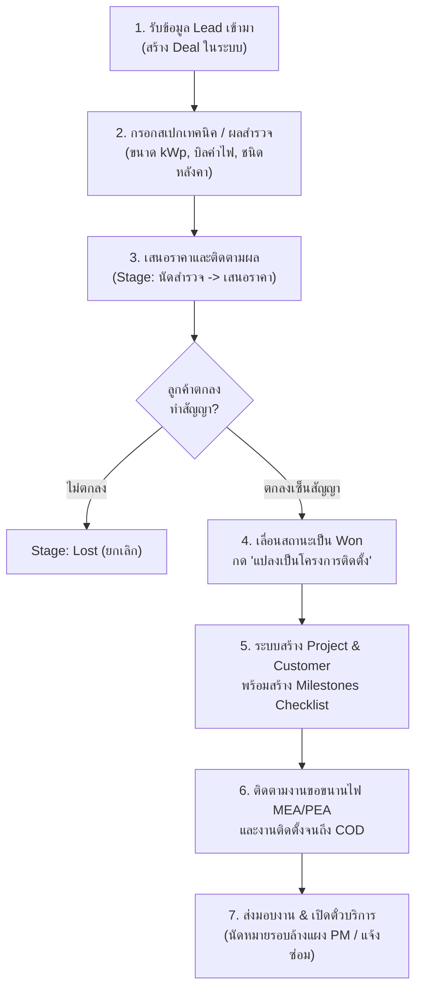

# คู่มือการใช้งานระบบ CRM & Field Service Management (User Manual)
**ระบบ ABCPOS - สำหรับธุรกิจติดตั้ง Solar Cell, EV Charger และงานบริการช่างโครงการ**

---

## 📖 สารบัญ (Table of Contents)
1. [ภาพรวมของระบบ CRM & Field Service](#1-ภาพรวมของระบบ-crm--field-service)
2. [ผังกระบวนการทำงานแบบครบวงจร (End-to-End Workflow)](#2-ผังกระบวนการทำงานแบบครบวงจร-end-to-end-workflow)
3. [โมดูลที่ 1: จัดการโอกาสการขาย & งานสำรวจ (Deals & Pipeline)](#3-โมดูลที่-1-จัดการโอกาสการขาย--งานสำรวจ-deals--pipeline)
   - [3.1 การสร้างโอกาสการขายใหม่ (Add Deal)](#31-การสร้างโอกาสการขายใหม่-add-deal)
   - [3.2 การใช้งาน Technical Specs Preset (Solar Rooftop / EV Charger)](#32-การใช้งาน-technical-specs-preset-solar-rooftop--ev-charger)
   - [3.3 การเลื่อนสถานะขั้นตอนการขาย (Kanban Drag & Drop / Select)](#33-การเลื่อนสถานะขั้นตอนการขาย-kanban-drag--drop--select)
   - [3.4 การแปลงดีลเป็นโครงการติดตั้ง (Convert to Project)](#34-การแปลงดีลเป็นโครงการติดตั้ง-convert-to-project)
4. [โมดูลที่ 2: ติดตามโครงการติดตั้ง & งวดงาน (Projects & Installation)](#4-โมดูลที่-2-ติดตามโครงการติดตั้ง--งวดงาน-projects--installation)
   - [4.1 ภาพรวมหน้าจอแบบ Master-Detail](#41-ภาพรวมหน้าจอแบบ-master-detail)
   - [4.2 การอัปเดต Milestones Checklist (การขออนุญาต & ส่งมอบงาน)](#42-การอัปเดต-milestones-checklist-การขออนุญาต--ส่งมอบงาน)
5. [โมดูลที่ 3: งานบริการหลังการขาย & ซ่อมบำรุง (Service & Maintenance)](#5-โมดูลที่-3-งานบริการหลังการขาย--ซ่อมบำรุง-service--maintenance)
   - [5.1 การเปิดใบงานบริการใหม่ (Add Service Ticket)](#51-การเปิดใบงานบริการใหม่-add-service-ticket)
   - [5.2 รอบการบำรุงรักษาประจำรอบ (Preventive Maintenance - PM)](#52-รอบการบำรุงรักษาประจำรอบ-preventive-maintenance---pm)
   - [5.3 การอัปเดตสถานะงานบริการ](#53-การอัปเดตสถานะงานบริการ)
6. [การส่งออกข้อมูล (Export PDF & CSV / Excel)](#6-การส่งออกข้อมูล-export-pdf--csv--excel)
7. [คำถามที่พบบ่อย (FAQ)](#7-คำถามที่พบบ่อย-faq)

---

## 1. ภาพรวมของระบบ CRM & Field Service
ระบบ **CRM & Field Service** ใน ABCPOS ถูกออกแบบมาเพื่อตอบโจทย์ธุรกิจที่ให้บริการติดตั้งและงานบริการภาคสนาม (เช่น **ติดตั้งระบบ Solar Cell / Rooftop**, **ติดตั้งเครื่องชาร์จรถยนต์ไฟฟ้า EV Charger**, **กล้องวงจรปิด CCTV** และงานระบบไฟฟ้า/วิศวกรรม) โดยเชื่อมโยงตั้งแต่งานคัดกรองลูกค้ามุ่งหวัง การสำรวจหน้างาน การขออนุญาตหน่วยงานรัฐ งานติดตั้ง ไปจนถึงการบำรุงรักษาประจำปีและการล้างแผงโซลาร์เซลล์

---

## 2. ผังกระบวนการทำงานแบบครบวงจร (End-to-End Workflow)

---

## 3. โมดูลที่ 1: จัดการโอกาสการขาย & งานสำรวจ (Deals & Pipeline)
**URL เมนู:** `CRM & Field Service` ➔ `Deals & Pipeline` (`/crm/deals`)

หน้านี้ใช้สำหรับพนักงานขายและวิศวกรสำรวจหน้างานในการติดตามสถานะลูกค้าแต่ละรายในรูปแบบกระดาน **Kanban Board** และตาราง **Table View**

### 3.1 การสร้างโอกาสการขายใหม่ (Add Deal)
1. ไปที่เมนู **Deals & Pipeline**
2. คลิกปุ่มสีส้ม **`+ Add Deal`** มุมบนขวา
3. กรอกข้อมูลจำเป็นในแบบฟอร์ม:
   - **Title (ชื่องาน / หัวข้อดีล)\***: เช่น `ติดตั้ง Solar Rooftop 5kWp - บ้านคุณสมชาย`
   - **Customer / Contact (ชื่อลูกค้า)\***: ระบุชื่อผู้ติดต่อ
   - **Phone (เบอร์โทรศัพท์)\***: เบอร์ติดต่อสำหรับนัดหมาย
   - **Estimated Value (มูลค่าประเมิน)\***: ยอดเงินประมาณการของโครงการ (บาท)
   - **Stage**: เลือกขั้นตอนเริ่มต้น (ค่าเริ่มต้น: *Lead ใหม่*)
   - **Installation Address**: ที่อยู่สถานที่หน้างานติดตั้ง

### 3.2 การใช้งาน Technical Specs Preset (Solar Rooftop / EV Charger)
ภายในฟอร์มจะมีกล่อง **Technical Specs Preset** ให้เลือกตามประเภทงาน:
- กดเลือกแท็บ **`☀️ Solar Rooftop`**:
  - **ขนาดระบบ (kWp)**: เช่น `3.3`, `5.5`, `10.0`
  - **ค่าไฟเดิม (บาท/เดือน)**: เช่น `4,500`
  - **ประเภทหลังคา**: เลือกจากตัวเลือก เช่น *ซีแพคโมเนีย (CPAC)*, *เมทัลชีท (Metal Sheet)*, *กระเบื้องลอนคู่ (Roman Tile)*, *ดาดฟ้าคอนกรีต (Slab)*
  - **เฟสไฟ & การไฟฟ้า**: เลือกระบบ *1-Phase* หรือ *3-Phase* และหน่วยงาน *MEA (นครหลวง)* หรือ *PEA (ภูมิภาค)*
- กดเลือกแท็บ **`⚡ EV Charger`**: สำหรับสลับไปบันทึกข้อมูลรถยนต์ไฟฟ้าและขนาดเบรกเกอร์/มิเตอร์
4. คลิกปุ่ม **`Save Deal`** ข้อมูลจะถูกบันทึกและขึ้นการ์ดบนกระดานทันที

### 3.3 การเลื่อนสถานะขั้นตอนการขาย (Kanban Drag & Drop / Select)
- บนการ์ดแต่ละใบ จะมี Dropdown ให้เลือกย้าย Stage ได้ทันที เช่น จาก `Lead ใหม่` ➔ `นัดสำรวจหน้างาน` ➔ `เสนอราคา (Quotation)`
- ยอดเงินมูลค่าโครงการรวมในแต่ละคอลัมน์จะถูกคำนวณใหม่แบบอัตโนมัติ

### 3.4 การแปลงดีลเป็นโครงการติดตั้ง (Convert to Project)
เมื่อลูกค้าตกลงทำสัญญาและเลื่อนสถานะดีลมาที่คอลัมน์ **ปิดการขายสำเร็จ (Won)**:
1. การ์ดจะแสดงปุ่มสีเขียว **`แปลงเป็นโครงการติดตั้ง`**
2. เมื่อคลิกปุ่ม ระบบจะดำเนินการให้อัตโนมัติ:
   - ตรวจสอบและสร้างชื่อลูกค้าลงในระบบ **Master Data Customers** ทันที
   - ออกรหัสโครงการใหม่ เช่น `PRJ-2026-XXXX`
   - สร้างรายการ Checklist ขออนุญาตและการติดตั้งมาตรฐาน 6 ขั้นตอน
   - แสดงหน้าต่างแจ้งเตือนสำเร็จ พร้อมรหัสโครงการ

---

## 4. โมดูลที่ 2: ติดตามโครงการติดตั้ง & งวดงาน (Projects & Installation)
**URL เมนู:** `CRM & Field Service` ➔ `Projects & Install` (`/crm/projects`)

หน้านี้ใช้สำหรับผู้จัดการโครงการ (Project Manager), วิศวกร และทีมช่างติดตั้ง เพื่อติดตามความคืบหน้าของโครงการ

### 4.1 ภาพรวมหน้าจอแบบ Master-Detail
- **ฝั่งซ้าย (Projects List)**: แสดงรายการโครงการทั้งหมด พร้อมรหัสโครงการ, ชื่อลูกค้า, สถานะ และ **แถบแสดงความคืบหน้า (% Progress Bar)**
- **ฝั่งขวา (Project Details & Milestones)**: แสดงรายละเอียดโครงการที่เลือก, ข้อมูลสถานที่ติดตั้ง และรายการ Checklist ทั้งหมด

### 4.2 การอัปเดต Milestones Checklist (การขออนุญาต & ส่งมอบงาน)
Checklist มาตรฐานของโครงการ ประกอบด้วย:
1. *ยื่นเอกสารขออนุญาตขนานไฟ (MEA / PEA)*
2. *จัดเตรียมอุปกรณ์และส่งมอบหน้างาน*
3. *ติดตั้งโครงสร้างและแผง/อุปกรณ์*
4. *ทดสอบระบบและเชื่อมต่ออินเวอร์เตอร์ (Commissioning)*
5. *การไฟฟ้าตรวจสอบและเปลี่ยนมิเตอร์ (COD)*
6. *ส่งมอบงานและเอกสารรับประกันแก่ลูกค้า*

> 💡 **วิธีอัปเดตงาน:**  
> คลิกที่แถวของขั้นตอนนั้นๆ ระบบจะสลับสถานะระหว่าง **"รอดำเนินการ"** ➔ **"เสร็จสมบูรณ์ (✓)"** ให้ทันที และแถบ Progress Bar จะขยับเพิ่มขึ้นตามเปอร์เซ็นต์งานที่เสร็จ

---

## 5. โมดูลที่ 3: งานบริการหลังการขาย & ซ่อมบำรุง (Service & Maintenance)
**URL เมนู:** `CRM & Field Service` ➔ `Service & Maintenance` (`/crm/services`)

หน้านี้ใช้สำหรับทีม Operation & Maintenance (O&M) เพื่อจัดตารางนัดหมายและบันทึกงานบริการหลังการขาย

### 5.1 การเปิดใบงานบริการใหม่ (Add Service Ticket)
1. ไปที่เมนู **Service & Maintenance**
2. คลิกปุ่มสีส้ม **`+ Add Ticket`**
3. ระบุรายละเอียดใบงาน:
   - **Title (หัวข้องานบริการ)\***: เช่น `ล้างแผงโซลาร์เซลล์ประจำรอบ 6 เดือน`, `ตรวจสอบ Inverter แจ้งเตือน Error`
   - **Customer (ลูกค้า)\***: เลือกลูกค้าจากระบบ
   - **Project (โครงการ)**: เลือกโครงการติดตั้งที่ผูกไว้ (หากมี)
   - **Service Type (ประเภทงาน)**:
     - ☀️ *Preventive Maintenance (PM)*: สำหรับงานตรวจเช็คตามรอบ/ล้างแผง
     - 🔥 *Emergency Repair*: สำหรับงานแจ้งซ่อมด่วน
     - ⚙️ *Installation*: สำหรับงานติดตั้งเพิ่มเติม
     - 📋 *General*: งานบริการทั่วไป
   - **Scheduled Date**: วันที่นัดหมายเข้าหน้างาน
   - **Technician / Team**: ชื่อช่างหรือทีมงานผู้รับผิดชอบ
4. คลิก **`Create Ticket`**

### 5.2 รอบการบำรุงรักษาประจำรอบ (Preventive Maintenance - PM)
สำหรับธุรกิจ Solar Cell แนะนำให้เปิดใบงาน PM ตามรอบระยะเวลา:
- **รอบ 6 เดือน**: ล้างทำความสะอาดแผงโซลาร์เซลล์ และตรวจสอบสายดิน
- **รอบ 1 ปี**: ตรวจสอบค่าความต้านทานฉนวน (Insulation), ขันแน่นขั้วต่อ MC4 และตู้ไฟ AC/DC, ตรวจสอบการผลิตไฟฟ้าผ่าน Inverter Monitoring

### 5.3 การอัปเดตสถานะงานบริการ
สามารถเปลี่ยนสถานะของใบงานผ่าน Dropdown ในคอลัมน์ Action ได้ทันที:
- `Scheduled` (นัดหมายแล้ว)
- `In Progress` (กำลังเข้าบริการหน้างาน)
- `Resolved` (งานเสร็จสมบูรณ์)
- `Cancelled` (ยกเลิกการนัดหมาย)

---

## 6. การส่งออกข้อมูล (Export PDF & CSV / Excel)
ทุกหน้าจอของระบบ CRM มีปุ่มส่งออกข้อมูลมาตรฐานที่มุมบนขวา:
- **ปุ่มไอคอนสีแดง (Export PDF)**: คลิกเพื่อสั่งพิมพ์เอกสาร หรือบันทึกเป็น PDF (`window.print()`)
- **ปุ่มไอคอนสีเขียว (Export Excel / CSV)**: คลิกเพื่อดาวน์โหลดไฟล์ `.csv` นำไปเปิดใน Microsoft Excel หรือ Google Sheets เพื่อทำรายงานสรุปยอดขาย

---

## 7. คำถามที่พบบ่อย (FAQ)

**Q1: หากต้องการนำระบบไปใช้กับงานติดตั้งแอร์ หรือกล้องวงจรปิด (CCTV) ได้หรือไม่?**  
**A:** ได้ทันทีครับ เนื่องจากโครงสร้างระบบถูกออกแบบเป็น **Universal Field Service** ในช่อง Custom Attributes สามารถปรับเปลี่ยนไปบันทึกข้อมูลสเปกกล้องวงจรปิด หรือยี่ห้อแอร์ได้โดยไม่ต้องแก้ไขฐานข้อมูล

**Q2: ข้อมูลลูกค้าในหน้า CRM Deals กับหน้า Customers (`/customers`) เชื่อมกันอย่างไร?**  
**A:** ในขั้นตอน Deal พนักงานขายสามารถกรอกข้อมูลเบื้องต้นของ Lead ได้อย่างอิสระ เมื่อดีลชนะและกดปุ่ม *"แปลงเป็นโครงการติดตั้ง"* ระบบจะทำการโอนข้อมูลชื่อ, เบอร์โทร, ที่อยู่ ไปสร้างเป็น Customer ในระบบหลักให้ทันทีโดยไม่ต้องพิมพ์ซ้ำ

**Q3: สามารถค้นหาข้อมูลตามเบอร์โทรศัพท์หรือช่างผู้รับผิดชอบได้หรือไม่?**  
**A:** ได้ครับ ทุกหน้าจอมีช่องค้นหา Real-time Search สามารถพิมพ์ชื่อ, เบอร์โทรศัพท์, รหัสดีล/โครงการ หรือชื่อช่าง เพื่อกรองข้อมูลได้ทันที
